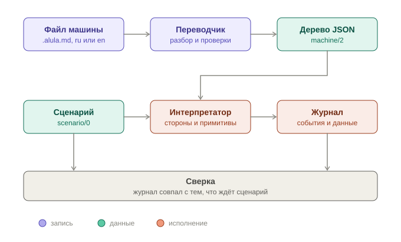
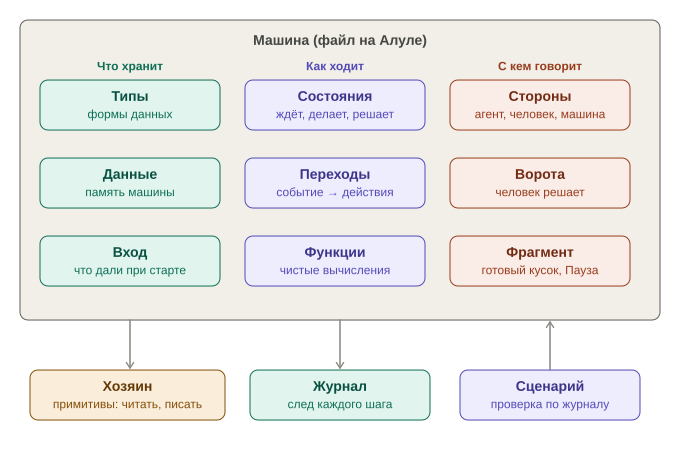

# Как работает Алула

**Пояснение, не норма.** Этот файл ничего не определяет. Единственное определение языка — [state-machine-alula-spec.md](state-machine-alula-spec.md) (версия 2.22); при расхождении прав он. Ссылки «раздел N» ниже ведут в него.

**Алула** — табличная запись стейт-машины. Машина — это состояния, строки переходов и данные. Работу в ней делают стороны: агент, человек, вложенная машина. Человек и агент — равные стороны: оба получают запрос и дают типизированный ответ (раздел 1, «`## Стороны`»).

## Шаги

**Файл машины.** Markdown-файл `*.alula.md`: шапка, затем разделы `## Типы`, `## Данные`, `## Стороны`, `## Состояния`, `## Концы` и другие, по порядку раздела 1. Файл пишется по-русски или по-английски (`- language: en`); слова двух форм — в [таблице слов](alula-keywords.tsv) (раздел 1а).

**Переводчик и проверки.** Переводчик разбирает файл и проверяет его: типы, имена, исчерпание развилок, кто пишет данные (раздел 10). Ошибка проверки — машина не собирается.

**Дерево `machine/2`.** Результат перевода — дерево JSON `<имя>.alula.json` (раздел 6). Это та же Алула в исполняемом виде, а не другой формат. Дерево одинаково для русского и английского файла: слова обоих языков дают одни ключи (раздел 1а). Имена в дереве — JSON-имена: строятся автоматически или задаются разделом `## Имена`. Схемы дерева и сценария лежат в [nv-lang/nova-alula, `src/machine/schema/`](https://github.com/nv-lang/nova-alula/tree/main/src/machine/schema).

**Интерпретатор.** Исполняет дерево. Стороне он шлёт запрос и ждёт ответ: виды сторон — `agent`, `human`, `enhanced`, вратарь (`human или agent по настройке`), `machine` (раздел 1). Всё, что машина делает с внешним миром, — примитивы хозяина (раздел 7). Класс примитива говорит, где его можно звать:

| Класс | Что делает |
|---|---|
| `pure` | чистая функция |
| `reading` | читает объект, хранилище, время; данные машины не меняет |
| `writing` | пишет внутри фиксации шага |
| `irreversible` | внешнее действие без отката; последним этапом фиксации |

**Журнал.** Каждый шаг пишет события журнала: код и параметры-тексты (тип `СобытиеЖурнала`, раздел 2; действия — раздел 5).

**Сценарий и сверка.** Сценарий `scenario/0` (`<имя>.scenario.test.json`) — события и ожидание: состояние, журнал, часть данных, очередь. Прогон сравнивает их с тем, что дал интерпретатор (раздел 11).

## Из чего состоит машина

**Типы.** Формы данных: записи, перечисления, варианты (`## Типы`). Нужны, чтобы проверка знала поля входа, запроса, ответа и данных. С ними работают все остальные части. Раздел 2; подробно — [alula-data-types.md](alula-data-types.md).

**Данные.** Память машины: таблица `## Данные` с типом, начальным значением, границей `не убывает` и владельцем `пишет`. Живут весь экземпляр, переживают паузу и перезапуск. Их читают запросы и условия, меняют действия переходов. Раздел 2, «Данные» и «Время жизни данных».

**Вход.** Что дали машине при старте (`## Вход`). Не меняется; из него `начальное` собирает данные. Раздел 1.

**Состояния.** Четыре вида (раздел 4): **обращение** — ждёт ответа стороны (4.2); **операция** — делает шаг сразу (4.5); **развилка** — выбирает путь по условиям (4.6); **конец** — даёт ответ вызова: `Ответ` или `Отказ` (4.7, `## Концы`).

**Переходы.** Строки таблицы состояния: `№`, событие, условие, действия, «Куда». Событие — ответ, сбой, сигнал, `сразу`; действия меняют данные и пишут журнал. Разделы 4.3, 5.

**Функции.** Чистые вычисления автора (`## Функции`), класс `pure`. Зовутся из выражений, данные не меняют. Разделы 8, 12 (каталог встроенных).

**Стороны.** Кто делает работу (`## Стороны`): `agent`, `human`, `enhanced`, вратарь (`human или agent по настройке`), вложенная машина `machine`. У стороны — тип результата `итог`. Обращение шлёт стороне запрос и ждёт ответ. Раздел 1.

**Ворота.** Сторона `human` со счётчиком — ворота: человек решает сигналом из столбца «сигналы» (ответ типа `ИсходВорот`). Идентификатор запроса — `<идентификатор>-<номер>`; отметка «принято» у ворот хранится с состоянием машины, поэтому ответ принимается один раз. Раздел 1 (правило 19), раздел 2, «Время жизни данных».

**Фрагмент.** Готовый кусок машины в своём файле (`fragment`): параметры, данные, общие события, состояния. Подключается в `## Подключения` и подставляется в машину; пример — «Пауза» с состоянием ПАУЗА. Раздел 9.

**Хозяин.** Даёт примитивы — всё, что касается внешнего мира: время, объекты, эффекты. Классы `pure`, `reading`, `writing`, `irreversible` задают, где примитив можно звать. Раздел 7.

**Журнал.** След каждого шага: события с латинским кодом и параметрами-текстами (`СобытиеЖурнала`). Пишется в фиксации шага. Разделы 2, 5; [state-machine-journal.md](state-machine-journal.md).

**Сценарий.** `scenario/0`: события и ожидание — состояние, журнал, часть данных, очередь. Прогон сверяет их с исполнением. Раздел 11.

**Как они взаимодействуют на одном шаге.** Обращение по таблице «Запрос» собирает из данных запрос стороне. Сторона отвечает значением своего `итог`. Строка перехода ловит ответ образцом, проверяет условие и выполняет действия: меняет данные, зовёт примитивы хозяина, пишет журнал. Затем машина идёт в состояние из «Куда». Разделы 4.2, 4.3, 5, 7.

## Где посмотреть

- Образцы: [state-machine-agent-step.alula.md](state-machine-agent-step.alula.md) («Шаг агента»; английский близнец — [state-machine-agent-step.en.alula.md](state-machine-agent-step.en.alula.md)) и [task-runner-meeting.alula.md](task-runner-meeting.alula.md) («Совещание агентов»).
- Типы данных и как они работают вместе — [alula-data-types.md](alula-data-types.md).
